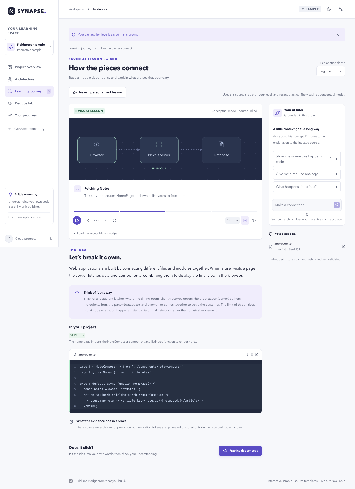
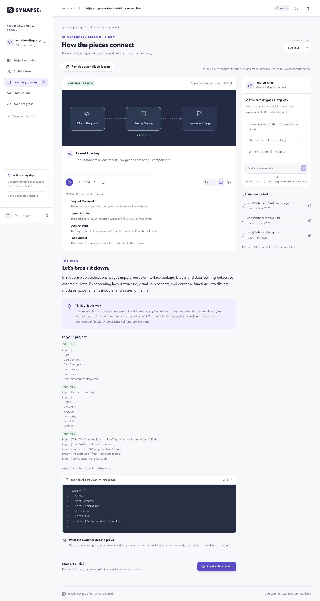
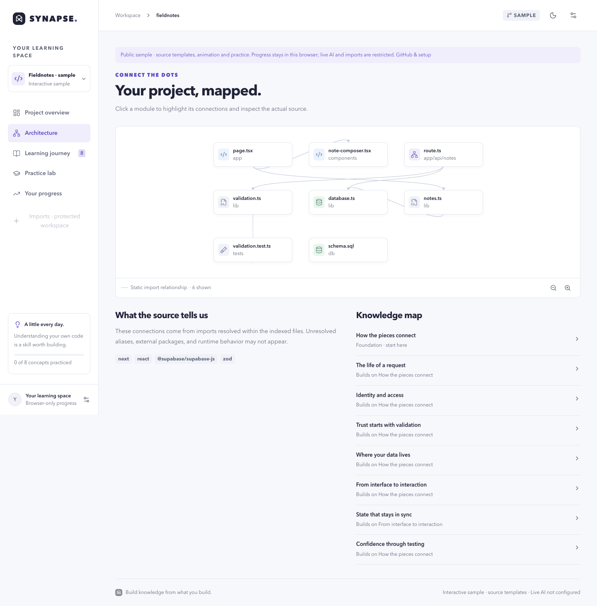
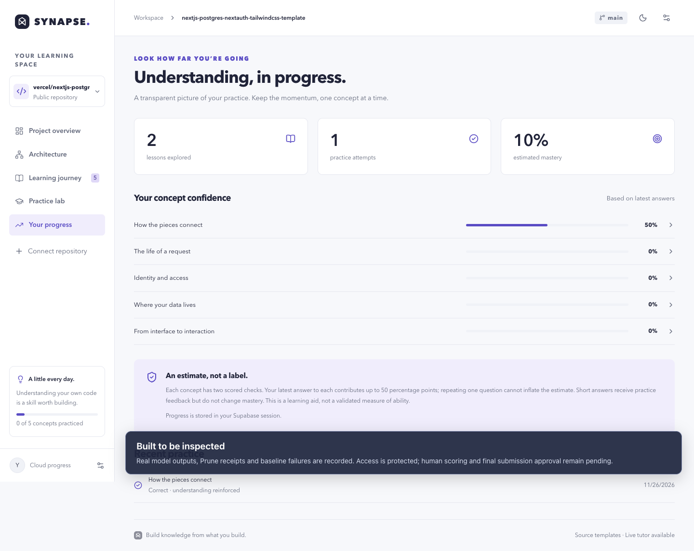
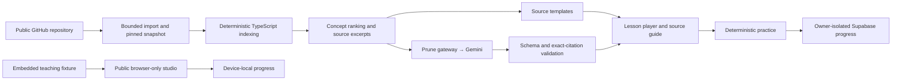

<div align="center">

# SYNAPSE

### Build knowledge from what you build.

**Turn an AI-assisted project into something you can explain.**

[Explore the product](#try-synapse) · [Demonstration](docs/DEMO_SCRIPT.md) · [Engineering](docs/ARCHITECTURE.md) · [Verification](https://github.com/pranav-pokkula/synapse/actions)

</div>



You can ship working code and still struggle to explain how its pieces fit together. SYNAPSE makes your project the curriculum: inspect its source, follow dependencies, study the underlying concepts, and practice explaining what the evidence establishes.

Built for students and early-career developers preparing for project reviews, interviews, or their next technical decision. This is the product hypothesis—not a claim of measured learning gains.

## Try SYNAPSE

**Public release:** the browser-only sample is prepared for deployment; the verified URL will be recorded in the [final handoff](docs/FINAL_SUBMISSION_HANDOFF.md). It needs no account or paid AI. Architecture, source excerpts, animated lessons, narration, template guidance and deterministic practice run locally in your browser. Progress stays on that device.

**Full AI experience:** the [protected preview](https://synapse-learning-qr1qac164-pranav-pokkulas-projects.vercel.app) requires authorized Vercel sign-in. It supports real public-repository imports, Gemini teaching through Prune, and hosted Supabase progress. Those services are deliberately unavailable in public production.

**Demo:** the owner-approved **3:03 silent, captioned recording** shows saved real AI output and hosted progress. [Video notes and upload status](docs/DEMO_SCRIPT.md). The recording is local until the owner supplies a video URL. Browser narration was separately tested and approved by the owner on November 26, 2026.

## From code to understanding

| Import | Understand | Learn | Practice |
|---|---|---|---|
| Read a bounded public JS/TS repository at an exact commit. | Inspect static module connections and a prerequisite-aware learning path. | Open source-linked explanations at three depths; play conceptual scenes or listen to their captions. | Answer deterministic checks, explain the code in your own words, and revisit unfinished concepts. |

Import and live generation run in the protected or locally configured studio. The public edition starts from the labeled **Fieldnotes teaching fixture**; it does not simulate a live import or model response.

## A learning workspace with evidence beside the explanation

- **Architecture you can inspect.** TypeScript-based indexing resolves static imports and links them to exact files. It does not infer runtime execution or production infrastructure.
- **Lessons at your depth.** Beginner, intermediate and advanced explanations share source references, conceptual SVG animations, captions and an accessible transcript.
- **AI with a constrained output contract.** Gemini supplies structured claims and scene data through Prune. Invalid citations or unsupported scene shapes are rejected; generated scripts are never executed.
- **A source guide when AI is off.** Clearly labeled templates explain locations, analogies and limitations; unsupported questions receive an abstention.
- **Practice with honest scoring.** Multiple-choice checks use fixed answers. Repeating one answer cannot stack mastery points; free-text explanations are ungraded practice.
- **Progress with clear boundaries.** The public sample saves in browser storage. The protected studio uses owner-isolated Supabase records and expiring write locks.

<details>
<summary><strong>See the real interface: generated lesson, architecture and progress</strong></summary>

**Generated lesson in the protected AI workspace**



**Architecture in the public sample**



**Saved progress in the protected workspace**



Screenshots are genuine captures. The generated lesson and hosted progress shown here belong to the protected experience; public production uses source templates and browser storage.

</details>

## How it works



The upper path is the full protected studio. The lower path is the public edition; it has no model or database connection. Imported repository code is treated as data, never installed or executed.

| Component | Purpose |
|---|---|
| Next.js · React · TypeScript | Typed application, route handlers and accessible interactive workspace |
| TypeScript compiler API | Structural indexing of selected source files |
| Prune · Google Gemini · Zod | Actual model gateway, structured teaching and runtime output validation |
| Supabase · PostgreSQL | Anonymous authenticated sessions, owner RLS, write fencing and shared quotas |
| SVG · Web Speech API | Conceptual animation and optional device-supported narration |
| Vitest · PGlite · Playwright · axe | Unit, SQL, security, browser and accessibility verification |
| Vercel | Separate protected full workspace and restricted public sample |

See [architecture and trust boundaries](docs/ARCHITECTURE.md) for the complete design.

## Engineering evidence, not accuracy claims

The original Stage 2 release passed **91 unit/SQL/security tests**, **12 browser checks**, **16 hosted database checks**, **16 protected-preview checks**, and **6 additional hosted assessment checks**. Final public-release checks and exact commits are recorded in the [release audit](docs/RELEASE_AUDIT.md) and [handoff](docs/FINAL_SUBMISSION_HANDOFF.md).

The paired experiment retained **all 20 attempts**:

| Outcome | Limited-context baseline | SYNAPSE retrieval |
|---|---:|---:|
| Accepted, non-abstaining answers | 0 | **5** |
| Accepted abstentions | 9 | 2 |
| Upstream HTTP 503 | 1 | 2 |
| Rejected citation | 0 | 1 |

Same serving model and settings; alternating order; caches disabled; no retries. The baseline received the first two indexed files; SYNAPSE received three retrieved excerpts. **Structural acceptance checks format and exact source text, not independent factual accuracy.** The small, deliberately limited baseline does not establish broad superiority, learning gains or time savings. Human explanation/code review remains outstanding.

Prune is the live gateway, not a decorative integration. Evidence includes a gateway-verified receipt, an observed Shield `429/rate_limit`, and ten exact-cache hits with zero gateway-estimated cost. The owner verified a $1/day Shield cap, 10 requests/minute and anomaly detection. No direct Gemini-versus-Prune savings or independently reconciled billing savings are claimed.

[Protocol and results](docs/EVALUATION_REPORT.md) · [All 20 outputs](evidence/stage2-evaluation-results.json) · [Receipt verification](evidence/prune-receipt-verification.json) · [Observed failures](docs/EXPERIMENT_NOTES.md)

## Run locally

Requires **Node.js 22** and npm.

```sh
npm ci
cp .env.example .env.local
npm run dev
```

Open **http://127.0.0.1:3000**. Without credentials, the local studio supports the sample, source templates and local filesystem history. Public GitHub imports require internet access but no paid model API. No repository code is executed.

For a browser-only public build, set `NEXT_PUBLIC_SYNAPSE_PUBLIC_SAMPLE=true` before building. For the full local/protected studio, leave it false and follow [configuration and security](docs/PUBLIC_RELEASE.md). Never put private credentials in `NEXT_PUBLIC_*` variables. Email OTP remains unverified.

```sh
npm run typecheck
npm run lint
npm test
npm run evaluate       # deterministic fixture checks; no paid model calls
npm run build
npm audit --audit-level=high
# In separate terminals, with Chrome installed:
npm start
npm run test:e2e
```

CI installs Chromium and uses `PLAYWRIGHT_CHROMIUM=1`. Live verification scripts use external quotas; the separate `scripts/evaluate-stage2.ts` makes paid model calls and is **not** part of routine CI.

## Deployment boundaries

Public production disables all server API/auth routes and contains no Prune or Supabase credentials. The sample uses browser storage, not Vercel's ephemeral filesystem. Clearing site storage clears its history; no cloud sync is advertised.

The full protected studio retains owner RLS and centralized ceilings: **8 model reservations/minute, 50/day UTC, 20/user/day, and 55 GitHub requests/hour**, alongside Prune Shield. A concurrent save can return a safe `409`; retry after it finishes. Data deletion does not revoke Auth accounts and an in-flight operation can recreate records. [Complete limitations and release gates](docs/RELEASE_AUDIT.md).

## Built during the Global AI Builder’s Challenge

SYNAPSE began in an empty workspace on November 22, 2026. Codex assisted coding, testing, debugging, design and documentation. Gemini through Prune is the AI inside the product; Codex is the development assistant. These are separate roles.

The owner approved browser narration and the complete silent demo on November 26. The separate five-explanation and three-code-change review is not recorded as complete. No human accuracy scores, learner studies or awards are claimed. Momen was not integrated. [AI development disclosure](docs/AI_DEVELOPMENT_LOG.md).

## Review and reproduce

| Start here | Deeper evidence |
|---|---|
| [Final submission handoff](docs/FINAL_SUBMISSION_HANDOFF.md) | [Evaluation report](docs/EVALUATION_REPORT.md) |
| [Devpost answers](docs/DEVPOST_SUBMISSION.md) | [Frozen experiment protocol](evidence/stage2-evaluation-manifest.json) |
| [Human review packet](docs/FINAL_REVIEW_PACKET.md) | [Release and security audit](docs/RELEASE_AUDIT.md) |
| [Architecture](docs/ARCHITECTURE.md) | [Build journal](docs/BUILD_JOURNAL.md) |
| [Public deployment configuration](docs/PUBLIC_RELEASE.md) | [Repository inventory and deletion record](docs/REPOSITORY_INVENTORY.md) |

## Next, after this release

Independent teaching review, a stronger full-context comparison, learner studies, and verified email account migration are future work. Broader language support and runtime-aware analysis are possibilities—not delivered features.
