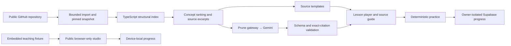

<div align="center">

# SYNAPSE

### Build knowledge from what you build.

**A learning workspace for understanding the software you create.**

[Try SYNAPSE](https://synapse-learning-one.vercel.app) · [Source](https://github.com/pranav-pokkula/synapse) · [Demonstration](docs/DEMO_SCRIPT.md) · [Architecture](docs/ARCHITECTURE.md) · [CI](https://github.com/pranav-pokkula/synapse/actions)

Created and developed by **Pranav Pokkula**.

</div>

I noticed that AI coding tools make building software increasingly accessible, but understanding the resulting architecture, dependencies and tradeoffs is a different challenge. I wanted a learning experience that starts with the developer's own project, rather than a disconnected tutorial.

SYNAPSE turns source code into a path through those ideas: inspect the architecture, study an explanation, follow its evidence, and practice explaining what the code actually establishes.


## Explore the product

**[The public application](https://synapse-learning-one.vercel.app)** runs a genuine browser-only sample. Explore architecture and source excerpts, play animated lessons, use browser narration, and complete practice checks. Progress stays in that browser; no account or paid AI is required.

**The [protected full workspace](https://synapse-learning-qr1qac164-pranav-pokkulas-projects.vercel.app)** adds live public GitHub imports, Gemini teaching through Prune, and Supabase persistence. It requires authorized Vercel sign-in. These services are deliberately unavailable in the public sample.

The [3:03 demonstration](docs/DEMO_SCRIPT.md) shows the full protected experience with real saved AI output and hosted progress. It is a silent, captioned recording; the public video URL has not yet been published.

## Import → Understand → Learn → Practice

| Stage | What happens |
|---|---|
| **Import** | Read a bounded public JavaScript or TypeScript repository at an exact commit. Imported code is never installed or executed. |
| **Understand** | Inspect static module relationships and a learning path that puts prerequisites first. |
| **Learn** | Study explanations at three depths, watch conceptual scenes, listen to captions, and open the source beside each claim. |
| **Practice** | Check your understanding, explain the code in your own words, and revisit concepts that need more attention. |

The public edition begins with the labeled **Fieldnotes teaching fixture**. It does not simulate a live import or model response.

## Evidence beside the explanation

I designed the workspace around a simple question: *what in this project supports the explanation?* The source trail stays alongside the lesson so a learner can inspect the answer rather than accept it on presentation alone.

- **Source-grounded teaching.** The full workspace retrieves bounded excerpts for Gemini and requires structured claims with exact citations. Matching source text is a check on the reference, not proof that an interpretation is correct.
- **Diagrams and animation.** Static architecture maps show import relationships. Lesson scenes use a constrained SVG renderer and are labeled conceptual models, not runtime traces.
- **Read, watch or listen.** Beginner, intermediate and advanced lessons share source references. Visible captions also supply browser narration, with a transcript available throughout.
- **Practice with explicit rules.** Multiple-choice feedback uses fixed answers. Repeated answers cannot stack mastery points; free-text explanations remain ungraded practice.
- **A useful non-AI path.** Clearly labeled source templates explain locations, analogies and limitations when live generation is unavailable. Unsupported questions receive an abstention.

<details>
<summary><strong>Inside SYNAPSE: lessons, architecture and progress</strong></summary>

**A generated lesson in the protected workspace**


**Architecture in the public sample**


**Hosted progress in the protected workspace**


These are application captures. AI-generated lessons and hosted records belong to the protected workspace; public production uses templates and browser storage.

</details>

## Engineering approach

I kept indexing, validation, rendering and assessment deterministic, while using generative AI for explanations and structured learning scenes. This gives the model a useful role without giving it control over source execution, UI scripts or scoring.



The upper path is the full workspace. The public sample has no model or database connection.

| Technology | Role |
|---|---|
| Next.js · React · TypeScript · Tailwind CSS | Typed application, route handlers and interactive interface |
| TypeScript compiler API | Structural indexing without executing imported code |
| Prune · Google Gemini · Zod | Model gateway, structured teaching and runtime output validation |
| Supabase · PostgreSQL | Authenticated sessions, row-level ownership, write fencing and shared quotas |
| SVG · Web Speech API | Conceptual animation and device-supported narration |
| Vitest · PGlite · Playwright · axe | Unit, SQL, security, browser and accessibility checks |
| Vercel | Public sample and separately protected full workspace |

[Architecture](docs/ARCHITECTURE.md) explains the data flow and trust boundaries. [Development notes](docs/AI_DEVELOPMENT_LOG.md) cover the design decisions and AI-assisted process.

## What the evidence shows

Verification includes **98 unit/SQL/security/public-mode tests**, **12 full-studio browser checks**, **22 public-production checks**, **16 hosted database checks**, **16 protected-preview checks**, and **6 additional hosted assessment checks**. These are separate test groups, with dates and scope in the [release audit](docs/RELEASE_AUDIT.md).

The paired model experiment retained all **20 attempts**:

| Outcome | Limited-context baseline | SYNAPSE retrieval |
|---|---:|---:|
| Accepted, non-abstaining answers | 0 | **5** |
| Accepted abstentions | 9 | 2 |
| Upstream HTTP 503 | 1 | 2 |
| Rejected citation | 0 | 1 |

Both conditions used the same serving model and settings, alternating order, disabled caches and no retries. The baseline received the first two indexed files; SYNAPSE received three retrieved excerpts.

My conclusion is narrow: retrieval supplied usable evidence for five structurally accepted answers in this experiment. **Structural validation is not independent factual accuracy scoring.** This small, limited-context comparison does not establish general superiority or learning gains. The [evaluation report](docs/EVALUATION_REPORT.md) preserves the exact latency, token, cost and failure figures.

Prune is the actual Gemini gateway. Evidence includes a gateway-verified receipt, an observed Shield rate denial, and ten exact-cache hits with zero gateway-estimated cost. These observations do not establish direct Gemini-versus-Prune cost savings. [Integration findings and failures](docs/EXPERIMENT_NOTES.md).

## Run locally

Requires **Node.js 22** and npm.

```sh
npm ci
cp .env.example .env.local
npm run dev
```

Open **http://127.0.0.1:3000**. Without credentials, the local studio supports the sample, source templates and filesystem history. Public GitHub imports require internet access; live teaching requires configured model credentials and can incur provider charges.

```sh
npm run typecheck
npm run lint
npm test
npm run evaluate       # deterministic fixture checks; no paid model calls
npm run build
npm audit --audit-level=high
# With the production build running in another terminal:
npm start
npm run test:e2e
```

Local browser tests use Chrome; CI installs Chromium. Hosted configuration and public-mode reproduction are documented in [deployment boundaries](docs/PUBLIC_RELEASE.md). The separate Stage 2 model-evaluation script makes real provider requests and is not part of routine CI.

## Security and scope

Public production contains no Prune or Supabase credentials and denies server API/auth routes. Sample progress lives in browser storage, not Vercel's filesystem. The protected workspace retains owner RLS, expiring write locks, per-user quotas and deployment-wide limits alongside Prune Shield.

Only bounded public JS/TS repositories are supported. Static relationships cannot establish runtime behavior, and source matching cannot establish semantic correctness. Concurrent saves may require a retry. Email OTP, account migration and learning outcomes have not been verified. [Security boundaries and residual risks](docs/RELEASE_AUDIT.md).

## Development and next steps

I created SYNAPSE during the Global AI Builder's Challenge, beginning November 22, 2026. I directed the product and engineering work and used OpenAI Codex for implementation, debugging, testing and documentation. Gemini through Prune is the AI inside the product; Codex supported my development process. [Development and AI-use disclosure](docs/AI_DEVELOPMENT_LOG.md).

My next priorities are independent teaching evaluation, a stronger full-context baseline, learner studies and verified account migration. Broader language support and runtime-aware analysis are future directions, not delivered features.
