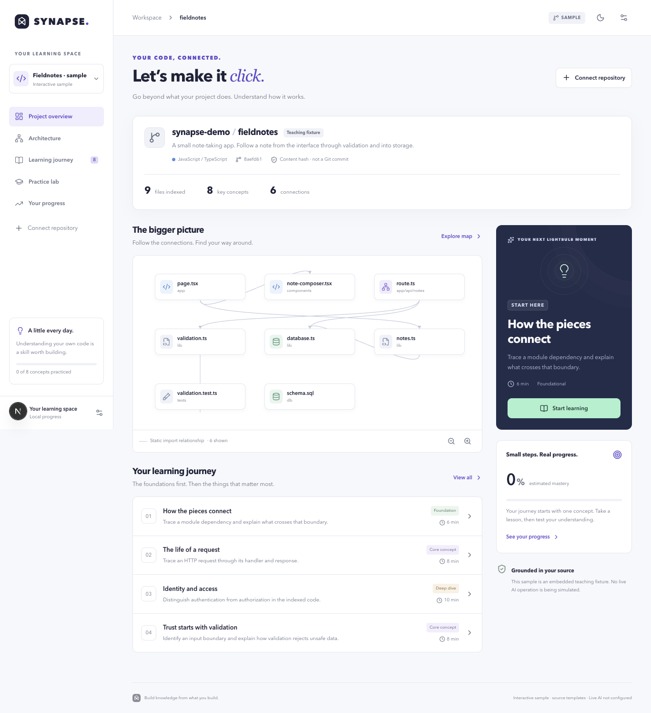

# SYNAPSE

**Build knowledge from what you build.**

A Next.js learning studio that turns public JavaScript and TypeScript repositories into source-linked architecture maps, prioritized concepts, animated lessons, and practical assessments.



Connect a repository, inspect the static architecture, follow a prerequisite-aware learning path, and read/watch/listen to a concept at your chosen depth. Open exact source excerpts, ask the template guide for context, and practice with deterministic feedback. The studio includes light/dark themes, mobile layouts, a transcript, and isolated local learner history.

## Run locally

Requires Node.js 22 and npm.

```sh
npm ci
cp .env.example .env.local
npm run dev
```

Open http://127.0.0.1:3000. The interactive Fieldnotes sample, public GitHub imports, template lessons, browser narration, and local progress work without paid APIs. No imported code is executed or installed. Local records live in ignored `.synapse/`, with a browser progress mirror.

## Current service boundaries

- **Source templates and the embedded teaching fixture are explicitly labeled.** They are not live model output. The fixture's hash identifies its contents, not a GitHub commit.
- Live tutor integration accepts an OpenAI-compatible chat-completions endpoint via `LLM_BASE_URL`, `LLM_MODEL`, and `LLM_API_KEY`. No model has been selected or benchmarked yet. Set `LLM_ALLOW_LOCAL=true` for an explicitly configured localhost model.
- Supabase integration uses a publishable key and user cookies, with owner RLS. Hosted setup is blocked by the account's free-project limit; no existing projects were changed. Apply `supabase/migrations/20261122102555_learning_records.sql` only to a **new SYNAPSE project**, enable anonymous auth and email auth, and configure callback URLs. Set the two `NEXT_PUBLIC_SUPABASE_*` variables.
- `APP_ORIGIN` must match the browser origin exactly. For the documented local command it is `http://127.0.0.1:3000`.
- `GITHUB_TOKEN` is optional and server-only. Public import does not require GitHub user authentication. Unauthenticated GitHub API quotas can limit repeated imports.
- Vercel cannot use the local filesystem persistence adapter. Cloud storage must be configured before deploying the complete app.

## Supported limits

Public GitHub root URLs only; up to 150 MB repository metadata size, 15,000 tree entries, 48 selected source files, 80 KB per file, and 1 MB indexed input. Six files are fetched per checkpoint. Partial coverage is visible. The static import graph resolves relative and conventional `@/` imports; runtime topology and arbitrary aliases are not inferred. Presence of tests does not establish that they pass.

## Verification

```sh
npm run typecheck
npm run lint
npm test
npm run build
# With the app running and Chrome available:
npm run test:e2e
npm run verify:live
# Broader live Next.js import (additional GitHub API quota):
npx tsx scripts/verify-next.ts
npm run evaluate
npm audit
```

Browser tests use installed Google Chrome by default. CI installs Chromium and selects it through `PLAYWRIGHT_CHROMIUM=1`. Live verification contacts public GitHub repositories and consumes API quota. The LLM benchmark is explicitly skipped unless configured and enabled with `RUN_LLM_EVAL=1`; it does not silently spend credits.

Executed locally: 68 unit/integration/security tests, 12 production-browser checks, typecheck, lint, production build, and a dependency audit with zero reported vulnerabilities. Live examples include three JS libraries and a 37-file Next.js dashboard. [GitHub Actions](https://github.com/pranav-pokkula/synapse/actions) runs the automated checks on every push.

The local captioned demo is `evidence/synapse-demo.mp4` (2:44, excluded from Git). Recreate the capture with `npx tsx scripts/record-demo.ts` while the app is running; see [demo notes](docs/DEMO_SCRIPT.md). Public video upload and human review remain pending.

See [release audit](docs/RELEASE_AUDIT.md), [evaluation report](docs/EVALUATION_REPORT.md), and [architecture](docs/ARCHITECTURE.md) for measured status and limitations. This is a working local release candidate, not a declaration of production readiness.
