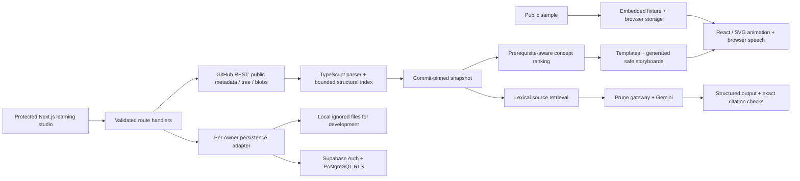

# Architecture

I designed SYNAPSE around an inspectable chain from source code to explanation. Imported code remains data, generated content passes an explicit contract, and the renderer controls what appears on screen. The public sample uses the same learning components without requiring paid services.

## Flow and boundaries

The product is one Next.js App Router web app on Node 22. No imported code, scripts, dependencies, or instructions are executed. TypeScript 6 is an intentional pin: TypeScript 7's native package did not expose the compiler API used here. Production uses the supported webpack build because the local Turbopack CSS build worker failed.

## Import and evidence

1. Accept only an HTTPS GitHub root URL with a validated owner and repository name. No user-controlled fetch host, credentials, query, branch, or fragment.
2. Confirm public visibility, size, default branch, and exact commit.
3. Select implementation/config/test files from the recursive tree; reject symlinks, secrets, binaries, generated directories, and oversized files. Limits: 150 MB repository metadata size, 15,000 tree entries, 48 indexed files, 80 KB per file, 1 MB total selected bytes.
4. Fetch six blobs per request. Save checkpoints after every batch. Preserve partial successes on failures; retry resumes the saved cursor. An owner’s existing identical commit snapshot is reused.
5. Parse imports, re-exports, requires, dynamic imports, and exported declarations without evaluation. Resolve relative and conventional `@/` paths against indexed files. Concepts use bounded implementation-pattern heuristics; these can miss or over-classify unusual code.
6. A citation consists of exact path, commit, inclusive line range, and verbatim text. Text equality is checked against the snapshot. This validates reference existence, **not semantic entailment**.

The fixture has a deterministic content hash and is explicitly not represented as a GitHub commit. Module diagrams show static import relationships; lesson scenes are labeled conceptual models rather than execution traces.

## Learning and model integration

Concept order respects prerequisites first, then architectural importance, difficulty, and observed practice gaps. Explanations have beginner, intermediate, and advanced versions. The same lesson object supplies visual captions and narration. The scene schema accepts only named nodes and transitions, never executable HTML or JavaScript.

The optional tutor retrieves bounded excerpts and includes current concept, level, and four recent conversation turns. It uses an OpenAI-compatible chat-completions endpoint selected by environment configuration. Output separates verified, inferred, general, and unknown claims. Invented citations and unreferenced verified claims are rejected. Prune uses the configured Gemini alias; live responses have served `gemini-3.5-flash-lite`. Native Gemini content is parsed without thought parts or signatures. Exact Prune caching is used for app calls, with routing disabled to keep the chosen model/provider explicit; benchmark calls disable gateway caching too. Template-mode guidance remains useful and clearly labeled.

Limits: 18,000 tutor context characters, 1,800 tutor / 3,200 lesson requested output tokens, 48 KB response, configurable timeout capped at 45 seconds, no automatic model retry, and 20 calls/user/day. Shared PostgreSQL counters enforce 8 reservations/minute, 50/day UTC and 55 GitHub requests/hour across identities and instances, failing closed when unavailable. The fixed $0.01 reservation is conservative internal accounting, not a provider-price guarantee. Prune Shield supplies the dashboard-verified $1/day cap; an actual uncached 429 verified its rate-denial path.

Generated lessons include summary, analogy, explicit claims, tradeoffs, and a strictly validated three-node scene. Step narration must be distinct, nodes/transitions must fit the existing renderer, and citations must match the snapshot. One caption string supplies visible text and speech. Model-generated HTML/scripts are rejected. Cached lessons are owner scoped and keyed by model, prompt version, source, level and learner context; failures preserve the previous valid lesson.

Two deterministic checks estimate mastery per concept. Each latest unique answer contributes 0 or 50 points; repeated attempts do not accumulate credit. Short explanations receive transparent keyword-rubric practice feedback and **do not** change mastery. Model-assisted open-answer grading is not implemented.

## Persistence and authorization

Local mode uses an opaque, HttpOnly, same-site UUID cookie and atomic JSON-file replacement under ignored `.synapse/<session>/`. Local mutation queues prevent concurrent writes within the process. This is single-machine development storage, not a Vercel persistence solution. The browser mirrors progress; server records are authoritative when available.

Supabase mode uses `@supabase/ssr`, cookie-based anonymous/email sessions, and `getUser()` validation. No service-role key is needed. `learning_records` stores typed JSONB records for profiles, jobs, snapshots, lessons, attempts, progress, and tutor history. Every query is owner-scoped and RLS enforces both USING and WITH CHECK. Rate counters have no direct client write privileges; a fixed-bucket function in a non-exposed schema validates the authenticated identity and caps requested limits. Records are payload-bounded. Quota metadata survives learning-data deletion.

Email sign-in opens that account’s history; guest progress is not automatically migrated. Account removal/revocation, CAPTCHA, email delivery, and abuse-related availability remain limitations of the full workspace. Expiring owner-scoped leases and fenced writes now protect import checkpoints and progress mutations across instances. The current delete control deletes learning data, not the Supabase account itself.

## Security and current limits

Provider keys stay on the server. Fixed GitHub API hosts, refused redirects, bounded JSON/stream reading, origin checks, same-site cookies, escaped React text, CSP/frame protection, safe scene schemas and per-owner data checks constrain external inputs. Sixteen hosted checks exercised real anonymous identities, refresh, RLS, deletion, lock contention, stale writes and atomic global limits. The dedicated database is TraceEval / synapse-learning (`fcwyithhipsimrnccqsy`); its two migrations are tracked in [`supabase/migrations`](../supabase/migrations).

The full workspace uses preview-only credentials behind Vercel Authentication. Its exact callback URL is allowlisted; actual email OTP delivery remains untested. The public production environment contains only the browser-sample switch. Its API/auth routes return `403/PUBLIC_SAMPLE_ONLY`, with additional production guards in identity and provider configuration. See [public release configuration](PUBLIC_RELEASE.md).

Residual limits: authenticated clients can consume their own or global reservation quota to deny availability, although they cannot enlarge the caps or trigger model calls through SQL. Learning-data deletion does not delete Auth users or revoke issued JWTs; an already running operation can repopulate data after deletion. Email OTP, account migration, independent semantic accuracy and learning outcomes are not verified.
