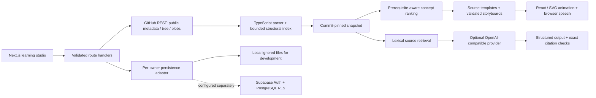

# Architecture

## Flow and boundaries

The product is one Next.js App Router web app on Node 22. No imported code, scripts, dependencies, or instructions are executed. TypeScript 6 is an intentional pin: TypeScript 7's native package did not expose the compiler API used here. Production uses the supported webpack build because the local Turbopack CSS build worker failed.

## Import and evidence

1. Accept only an HTTPS GitHub root URL with a validated owner and repository name. No user-controlled fetch host, credentials, query, branch, or fragment.
2. Confirm public visibility, size, default branch, and exact commit.
3. Select implementation/config/test files from the recursive tree; reject symlinks, secrets, binaries, generated directories, and oversized files. Limits: 150 MB repository metadata size, 15,000 tree entries, 48 indexed files, 80 KB per file, 1 MB total selected bytes.
4. Fetch six blobs per request. Save checkpoints after every batch. Preserve partial successes on failures; retry resumes the saved cursor. An owner’s existing identical commit snapshot is reused.
5. Parse imports, re-exports, requires, dynamic imports, and exported declarations without evaluation. Resolve relative and conventional `@/` paths against indexed files. Concepts use bounded implementation-pattern heuristics; these can miss or over-classify unusual code.
6. A citation consists of exact path, commit, inclusive line range, and verbatim text. Text equality is checked against the snapshot. This validates reference existence, **not semantic entailment**.

The fixture has a deterministic content hash and is explicitly not represented as a GitHub commit. Module diagrams show static import relationships; lesson scenes are labeled conceptual models rather than execution traces.

## Learning and model integration

Concept order respects prerequisites first, then architectural importance, difficulty, and observed practice gaps. Explanations have beginner, intermediate, and advanced versions. The same lesson object supplies visual captions and narration. The scene schema accepts only named nodes and transitions, never executable HTML or JavaScript.

The optional tutor retrieves bounded excerpts and includes current concept, level, and four recent conversation turns. It uses an OpenAI-compatible chat-completions endpoint selected by environment configuration. Output separates verified, inferred, general, and unknown claims. Invented citations and unreferenced verified claims are rejected. No model is preselected; no actual provider has been evaluated. Template-mode guidance remains useful and clearly labeled.

Limits: 18,000 context characters, 1,800 requested output tokens, 48 KB response, 25-second timeout, no automatic model retry, 20 calls per session/day by default, cached successful answers. These are per-session controls; anonymous-session churn and deployment-wide spend protection remain release concerns. Use a provider-side hard spending cap before opening live AI to the public.

Two deterministic checks estimate mastery per concept. Each latest unique answer contributes 0 or 50 points; repeated attempts do not accumulate credit. Short explanations receive transparent keyword-rubric practice feedback and **do not** change mastery. Model-assisted open-answer grading is not implemented.

## Persistence and authorization

Local mode uses an opaque, HttpOnly, same-site UUID cookie and atomic JSON-file replacement under ignored `.synapse/<session>/`. Local mutation queues prevent concurrent writes within the process. This is single-machine development storage, not a Vercel persistence solution. The browser mirrors progress; server records are authoritative when available.

Supabase mode uses `@supabase/ssr`, cookie-based anonymous/email sessions, and `getUser()` validation. No service-role key is needed. `learning_records` stores typed JSONB records for profiles, jobs, snapshots, lessons, attempts, progress, and tutor history. Every query is owner-scoped and RLS enforces both USING and WITH CHECK. Rate counters have no direct client write privileges; a fixed-bucket function in a non-exposed schema validates the authenticated identity and caps requested limits. Records are payload-bounded. Quota metadata survives learning-data deletion.

Email sign-in opens that account’s history; guest progress is not automatically migrated. Account removal/revocation, CAPTCHA, distributed progress transactions, and quota abuse protections need further release work. The current delete control deletes learning data, not the Supabase account itself.

## Security and current limits

Server-only provider keys; fixed GitHub API host; no redirect following; bounded JSON/stream reading; origin checks; same-site cookies; escaped React text; CSP/frame protection; safe diagram schema; per-owner data checks. Local two-session isolation and PostgreSQL RLS semantics have been tested. Hosted Auth/RLS and Vercel are unverified because a new free Supabase project could not be created. Local locks are not distributed locks; multi-instance import/progress concurrency needs verification before cloud release.
